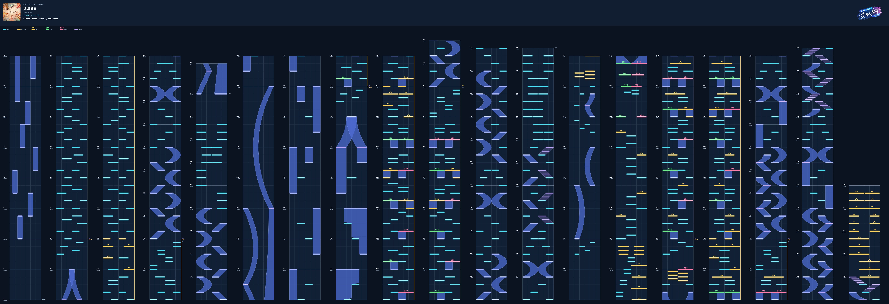

# Our Notes Chart Renderer


Read Our Notes `.ss` charts, analyze notes and render a 2D chart preview with Skia.
Both plain UTF-8 JSON and gzip-compressed SS files are supported.

## Example Usage

Requires Python 3.10+. Run the following commands from the project directory.

Install the dependencies:

```bash
python -m pip install -r requirements.txt
```

`parse_chart()` accepts JSON strings, JSON bytes or gzip-compressed SS bytes.
`parse_file()` detects compression automatically; no manual decompression or
filename change is needed. `parse_bytes()` is an alias of `parse_chart()`.

```python
from on_chart import RenderMetadata, parse_file, render, save_image

chart = parse_file("chart.ss")
image = render(
    chart,
    metadata=RenderMetadata(
        title="迷路日々",
        artist="MyGO!!!!!",
        difficulty="EXPERT",
        level="27.5",
    ),
)
save_image(image, "chart.png")  # render() returns a skia.Image.
```

The command-line renderer accepts chart files directly:

```bash
python render_preview.py chart.ss chart.png --title "My chart"
python render_preview.py chart.ss chart-mirror.jpg --mirror
```

Alternatively, install the package to use the console command:

```bash
python -m pip install .
ournotes-chart-render chart.ss chart.png
```

`python -m on_chart` also provides the same command-line interface. Run
`python render_preview.py --help` for all options.

## Sample Chart

2D chart preview for **迷路日々 (Melody)** by **MyGO!!!!!** [EXPERT]:



## License

See [LICENSE](LICENSE). The bundled Chiron Hei HK font is distributed under the
[SIL Open Font License](on_chart/assets/ChironHeiHK-SB-OFL.txt).
